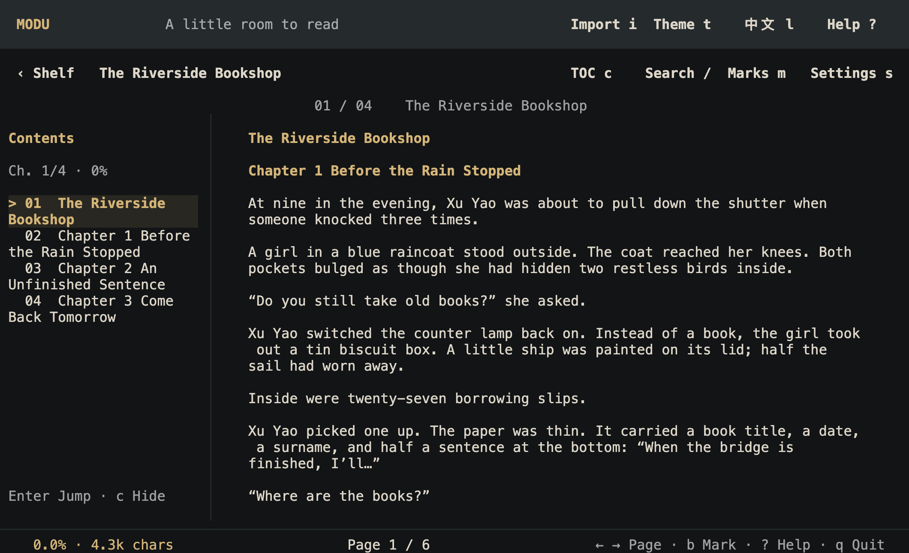
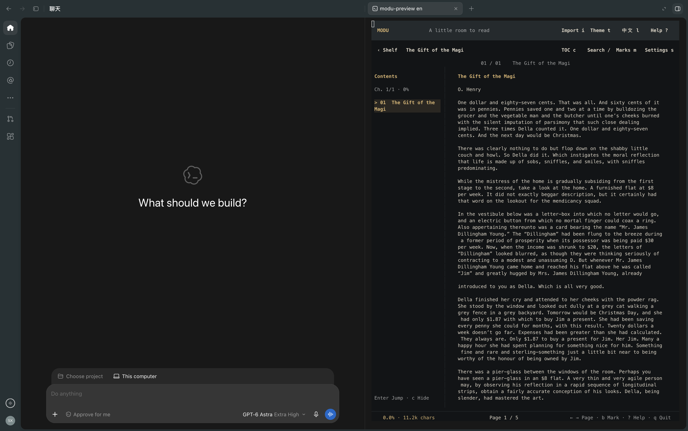
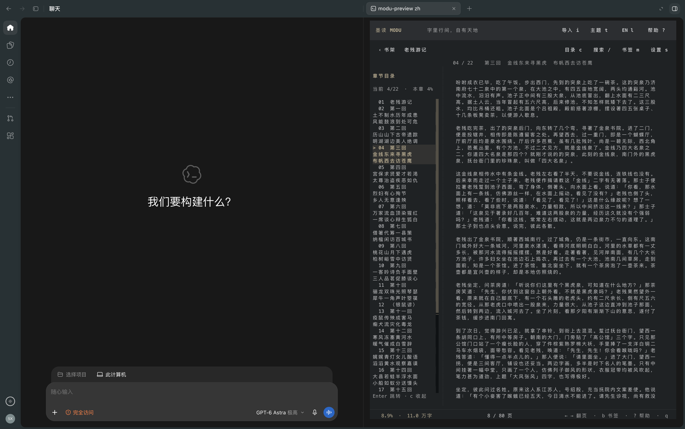
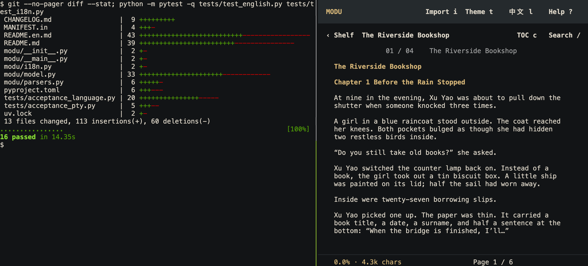

# MODU · A Chinese & English terminal ebook reader

English · [简体中文](README.md)

[Source](https://github.com/SitaoXie/modu-reader) · [Issues](https://github.com/SitaoXie/modu-reader/issues)

**Read a few pages while your code runs.**

MODU is an offline terminal ebook reader for Chinese and English, supporting TXT, EPUB, PDF, and Markdown. Read a novel in a nearby terminal while code, tests, builds, or coding agents run. Keep progress in view, and type `modu` next time to pick up where you left off.

- **Fits beside your work**: narrow-window layouts, a collapsible chapter sidebar, mouse scrolling, and keyboard paging.
- **Easy to put down and resume**: automatic position saving and source anchors that survive terminal resizing.
- **Comfortable in both languages**: CJK punctuation rules, intact English words and contractions, and eight coordinated reading themes.
- **Your books stay local.** Optional Web reading preserves EPUB and PDF layouts and supports translation on your device.



English text in the default black-and-gold theme. See the [Chinese README](README.md) for the light paper theme. This image was captured from real terminal output using original sample text; [image provenance](docs/product-images.md).

## Read a few pages first

Requires [uv](https://docs.astral.sh/uv/getting-started/installation/) and Python 3.11+. Download and extract the source, or clone the project, then enter the directory containing `pyproject.toml`. Try the included original English story:

```sh
git clone https://github.com/SitaoXie/modu-reader.git
cd modu-reader
uvx --from . modu --lang en --library ./test-artifacts/demo examples/first-pages.en.txt
```

For the Chinese example, use `examples/first-pages.txt` with `--lang zh`.

Press **Space** to turn a page, **c** for chapters, **t** for themes, and **q** to save and quit. Repeat the command to resume. The demo uses its own library under `test-artifacts/demo`, leaving the default library alone. The first run installs dependencies; reading works offline afterward.

To keep MODU available as a command:

```sh
uv tool install git+https://github.com/SitaoXie/modu-reader
modu --lang en
```

Press `i` to import your own book, or pass its path directly, for example `modu "book.epub"`. Quote paths containing spaces. Run `modu` again to resume automatically.

If the shell cannot find the command, follow uv's instructions to run `uv tool update-shell`, then reopen your terminal. MODU itself does not edit shell configuration, themes, system preferences, or another tool's notification settings. Install from the official GitHub source. This project has not been published to PyPI; do not install an unrelated package with the same name.

## Read between tasks, keep development in view







This is a real tmux session: project tests on the left, MODU on the right. Give the reader its own pane. Switch focus or press `q` to save and return to work.

| Environment | Suggested workflow and basis |
| --- | --- |
| VS Code | Split the integrated terminal: code or logs in one pane, `modu` in the other. [Official split-pane guide](https://code.visualstudio.com/docs/terminal/basics#_groups-split-panes) |
| Claude Code, Codex, and other coding tools | Use an adjacent terminal or pane while the agent's progress and approval prompts stay visible. Claude Code documents terminal support; adjacent reading beside Codex has user confirmation. [Claude Code docs](https://code.claude.com/docs/en/overview) |
| Shells, tests, and builds | Use side-by-side windows or a tmux split like the image above. An AI tool is optional. |

These workflows need no dedicated integration. MODU does not read AI conversations or receive task-completion events; keep using your development tool's notifications. VS Code and Claude Code terminal capabilities were checked against official documentation; their native UIs have not each undergone MODU acceptance testing. [Environment checks and test scope](docs/terminal-environments.md)

Antigravity also documents a side-panel terminal. Its native interaction has not been tested here, so it is listed as “possible, untested,” rather than verified support. [Official documentation](https://antigravity.google/docs/features#integrated-terminal)

**Status: 1.3.0b3 open-source release candidate.** Locally validated on macOS, including user confirmation of right-rail alignment and hiding in the target embedded terminal. Windows/Linux code paths and CI definitions are included, but native terminal acceptance is pending. The same commands can be tried in Windows Terminal with PowerShell. Use a terminal with mouse and truecolor support. The interface supports English and Simplified Chinese; book text stays in its original language.

## Interface language

Start in English with `modu --lang en`. Press `l` or click `中文 l` / `EN l` to switch instantly, or choose a language in reading settings (`s`). The choice is saved per library, including CLI help and import messages; simply run `modu` next time. Switching preserves book text, position, bookmarks, and theme. New libraries default to Simplified Chinese.

```sh
modu --lang en
modu --lang zh
modu --lang en --help
```

## Common commands

```sh
modu --shelf
modu --import-only examples/river.txt
modu --list
modu --library ./private-library
```

`--shelf` opens the bookshelf, `--import-only` imports without opening the reader, `--list` lists books, and `--library` selects a separate library.

## Web reading and selection translation

```sh
uv tool install --upgrade "modu-reader[webview,translation] @ git+https://github.com/SitaoXie/modu-reader"
modu --web
modu --web "My book.epub"
modu --serve
```

Run `modu --serve` and open [http://127.0.0.1:8765](http://127.0.0.1:8765) in the browser beside your code. The server accepts connections from this computer. Press `Ctrl+C` to stop it. Use `modu --serve --port 8766` if the default port is occupied.

The Web reader shares the shelf and themes and keeps its own reading positions and bookmarks. EPUB preserves the book's navigation, styles and bundled images. PDF renders the original pages and provides a selectable text layer when the file has text. Choose **Download renderer** on first PDF use to install the local PDF.js runtime. Use `modu --browser` to open the same reader in a browser. On macOS and Windows, the optional native window uses WebKit or WebView2.

Select a passage and click **Translate** next to the selection. Translation runs on the device without an account. The first use downloads the required model files. Choose a target in **Settings → Target for this book** to override only that book. The global setting defaults to the system language, with English as fallback when the system language is unavailable. Each selection can contain up to 600 characters. Scanned PDFs need a text layer for selection.

Use `←` / `→`, `PgUp` / `PgDn`, or the footer buttons to turn one screen at a time. Tall PDF pages span several screens and keep their original page number in the footer. Use Contents to jump directly.

## Reading features

- Import local TXT, EPUB, PDF, and Markdown files as independent library copies, with their storage directory shown during import. After a successful import, editing, moving or deleting the original does not affect reading; source changes are not synced.
- Bookshelf, table of contents, full-text search, bookmarks, and automatic resume.
- Archive, restore or delete books from the shelf, with confirmation. Archives retain bookmarks and progress. Deletion removes library copies and reading data while keeping the original imported file.
- Chapter sidebar with current-chapter marker and progress; press `c` to toggle it. Below 70 terminal columns it becomes a modal list.
- Mouse wheel, a draggable reading rail on the right, and keyboard paging. The rail hides after about two idle seconds without changing text width.
- Eight themes: black/gold, light paper, dark slate, warm sepia, pale green, light gray, graphite, and dark green. Press `t` to cycle or `s` to choose directly.
- **New page per chapter** is on by default: leave the rest of the last page blank and start the next chapter at the top. Toggle it in settings (`s`); your choice is saved.
- Current / total pages in the status bar, recalculated for window dimensions, paragraph spacing and chapter breaks. Long books are counted in the background while reading remains available.
- Source-character anchors preserve position across resizing and restart. The viewport renders on demand, with at most 512 cached paragraph layouts and three page-count row indexes.

| Action | Key |
| --- | --- |
| Next page | Space / Right / PgDn |
| Previous page | Left / PgUp / Backspace |
| Move one line | Up Down / k j |
| Start / end | Home / End |
| Contents / previous or next chapter | c / p n |
| Search | /, type, Enter, select a result, Enter |
| Toggle bookmark / list bookmarks | b / m |
| Theme / reading settings | t / s |
| Archive / restore, delete, archived shelf (on the bookshelf) | a / d / v |
| English / Chinese interface | l |
| Import / bookshelf / help | i / Esc / ? |
| Save and quit | q / Ctrl+q |

Terminal compatibility rendering may add zero-width characters to text copied from the screen. Original books and library text are unchanged.

Pages continue without repeating the previous page's last line, and resizing keeps the exact first source character. Page numbers describe the current terminal layout, change with font/window dimensions, and differ from printed or original PDF page numbers. Position is saved about every 0.5 seconds and immediately on normal exit. Font size is controlled by the terminal. Set `NO_COLOR` to disable colors.

## Formats and limits

- TXT supports UTF-8, BOM-marked UTF-16, GB18030, and other detectable encodings. Unnumbered chapter detection is heuristic, based on short headings and surrounding blank lines.
- The terminal follows EPUB spine order and displays image alternatives. DRM is unsupported; external resources are never fetched.
- The terminal uses **pypdf** for text extraction and reflow, not original-page rendering. Columns, complex tables, and font encodings can affect the result. There is no OCR. Encrypted PDFs are rejected; PDF JavaScript is not executed.
- Markdown becomes reading text with embedded HTML execution disabled. Links are not visited.
- Maximum source file: 64 MiB. EPUB: at most 4096 members, 8 MiB per member, and 64 MiB total expanded content. Documents: 8 million characters and 100,000 blocks. PDF: at most 2000 pages.
- Extraction runs in a child process terminated after 45 seconds. POSIX systems additionally attempt CPU/address-space limits. Windows does not receive those POSIX memory limits. This is not a complete OS security sandbox: import files from trusted sources.

## Local data and privacy

Terminal reading works offline. Web reading uses a temporary local loopback service. PDF rendering and new translation pairs download their components on first use and work offline afterward. Translation processes selected text on your device.

platformdirs chooses the user data directory with application name `MODU`:

| OS | Default library |
| --- | --- |
| macOS | `~/Library/Application Support/MODU/library` |
| Windows | `%LOCALAPPDATA%\MODU\library` |
| Linux | `${XDG_DATA_HOME:-~/.local/share}/MODU/library` |

Override this with `MODU_HOME` or `--library`. The library contains original copies, parsed caches, progress, bookmarks, and settings. It is local but **not encrypted**. Quit before backing it up. Never upload your library or private logs to a public repository or issue. Private permissions apply to newly created data directories; Windows inherits the user directory's access controls.

Folder imports skip hidden entries and symlinks, and stop at 1000 books. Book files are never executed through a shell. Older caches are rebuilt from the original copy inside the library.

## Tests and contributions

MODU is built with Python and Textual. From the project root:

```sh
uv sync --frozen
uv run modu
uv run pytest -q
uv run ruff check .
uv run bandit -r modu
uv run python tools/check_release.py .
uv run python tools/scan_secrets.py .
```

Real POSIX terminal regression requires `tmux` on PATH:

```sh
uv run python tests/acceptance_language.py --book examples/first-pages.en.txt --work ./test-artifacts/language
uv run python tests/acceptance_pty.py examples/river.txt --work ./test-artifacts/pty
uv run python tests/acceptance_cursor.py --work ./test-artifacts/cursor
uv run python tests/acceptance_chapters.py --work ./test-artifacts/chapters
uv run python tests/acceptance_scrollbar.py --python .venv/bin/python --work ./test-artifacts/rail
uv run python tests/acceptance_scrollbar.py --python .venv/bin/python --width-model narrow-punctuation --work ./test-artifacts/rail-narrow
uv run python tests/acceptance_scrollbar.py --python .venv/bin/python --width-model wide-ambiguous --work ./test-artifacts/rail-wide
```

Diagnostics exist only in the test driver. Their output is written under ignored `test-artifacts/` and must not be published as test material. Bundled tests/examples use original project text only. No commercial books, private reading history, real chat transcripts, or personal terminal configuration are included.

See [Contributing](CONTRIBUTING.md), [Security](SECURITY.md), [Release checklist](docs/release-checklist.md), and [Third-party notices](THIRD_PARTY_NOTICES.md).

[Validation record](docs/validation.md)

## License

Project code and original examples are [MIT](LICENSE)-licensed. Dependencies retain their own licenses. This candidate neither includes nor depends on PyMuPDF/MuPDF. It has no agent-control integration; any future optional notification adapter needs separate design, validation, and user authorization.
