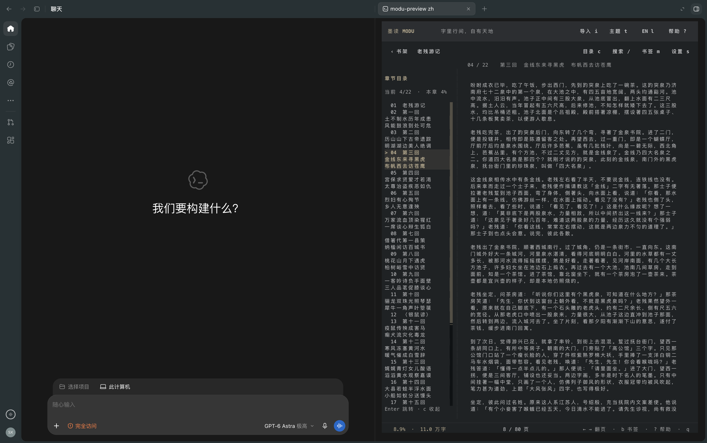
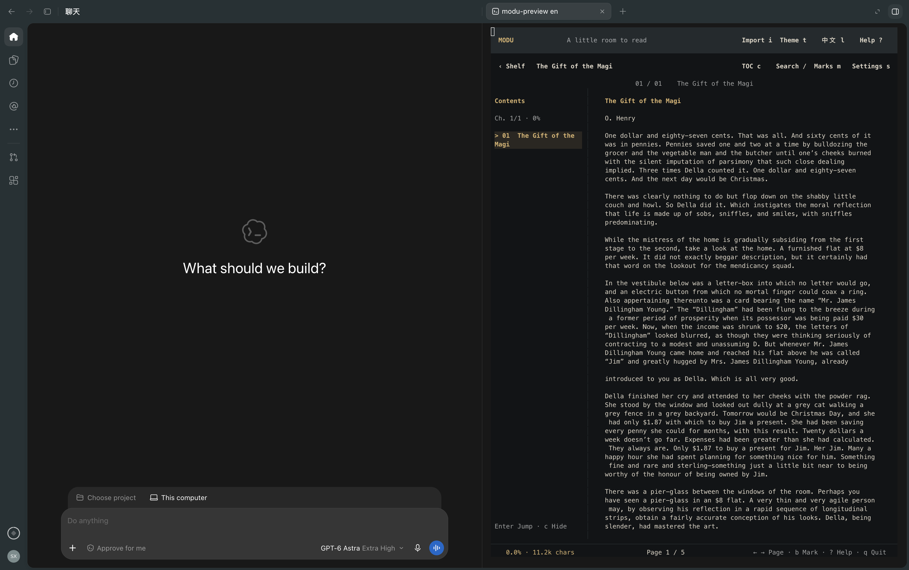
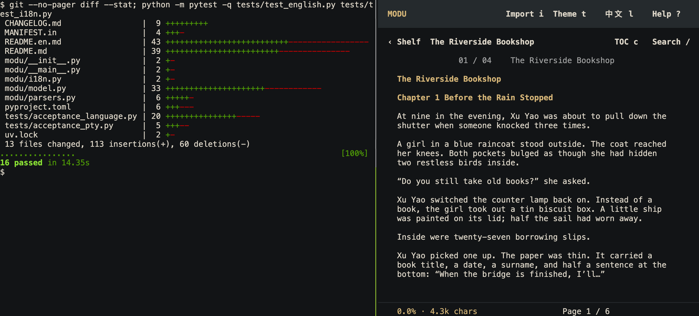

# 墨读 MODU · 中英文终端阅读器

[English](README.en.md) · 简体中文

[源码](https://github.com/SitaoXie/modu-reader) · [问题反馈](https://github.com/SitaoXie/modu-reader/issues)

**代码在跑，你在旁边读两页。**

MODU 是面向中文和英文阅读的离线终端电子书阅读器，支持 TXT、EPUB、PDF 和 Markdown。等代码执行、测试、构建或 AI 编程任务时，在旁边的终端读几页小说，让开发进度继续留在视野中；下次输入 `modu`，接着上次的位置读。

- **适合侧边阅读**：窄窗口排版、可收起的章节目录、滚轮与键盘翻页。
- **随时离开，随时接着读**：自动保存位置，调整终端大小后保持阅读锚点。
- **中英文都读得舒服**：中文标点避头尾、英文单词与缩写完整换行，八款协调的阅读主题。
- **书留在本机**：无需账户，运行时离线，无遥测、后台服务器或 WebView。


中文纸笺主题。英文黑金主题见 [English README](README.en.md)。上图使用原创示例与真实终端输出，详见[截图说明](docs/product-images.md)。

## 先读两页

需要 [uv](https://docs.astral.sh/uv/getting-started/installation/) 与 Python 3.11+。下载源码并解压，或克隆项目后，进入包含 `pyproject.toml` 的目录，用自带的原创短篇试读：

```sh
git clone https://github.com/SitaoXie/modu-reader.git
cd modu-reader
uvx --from . modu --library ./test-artifacts/demo examples/first-pages.txt
```

英文示例可将最后一行换为 `uvx --from . modu --lang en --library ./test-artifacts/demo-en examples/first-pages.en.txt`。

按 **Space** 翻页，**c** 看目录，**t** 换主题，**q** 保存退出。再次运行同一命令即可续读。示例书库单独保存在 `test-artifacts/demo`，不影响默认书库；首次运行需安装依赖，之后阅读可离线进行。

喜欢这个体验，再安装成随时可用的命令：

```sh
uv tool install git+https://github.com/SitaoXie/modu-reader
modu
```

在界面中按 `i` 导入自己的书，或直接传入文件路径，例如 `modu "book.epub"`；路径包含空格时加引号。以后输入 `modu` 即可自动续读。

如 shell 找不到命令，可按 uv 的提示运行 `uv tool update-shell` 并重新打开终端。项目本身不修改 shell 配置、主题、系统偏好或其他工具的通知设置。当前通过官方 GitHub 源码安装，尚未发布到 PyPI；不要把同名在线包当作本项目。

## 用碎片时间读书，保留开发进度







上图是 tmux 中真实的项目测试输出和 MODU。阅读器使用单独的终端窗格；需要处理开发任务时，切换焦点或按 `q` 保存退出。

| 工作环境 | 推荐用法与确认依据 |
| --- | --- |
| VS Code | 在集成终端使用 Split Terminal，一侧运行代码或查看日志，另一侧运行 `modu`。[官方分屏说明](https://code.visualstudio.com/docs/terminal/basics#_groups-split-panes) |
| Claude Code、Codex 等编程工具 | 把 MODU 放在独立终端或分屏中，保留代理的进度和审批提示。Claude Code 官方确认支持终端运行；Codex 旁侧阅读已由使用者验证。[Claude Code 文档](https://code.claude.com/docs/en/overview) |
| 普通命令行、测试、构建 | 使用并排窗口，或像上图一样用 tmux 分屏；无需运行 AI 工具。 |

这些是终端工作方式，不需要专用插件。MODU 不读取 AI 对话，也不自动接收任务完成通知；可使用开发工具自身的通知功能。VS Code / Claude Code 的终端能力已按官方资料核对，专属原生界面尚未逐项验收。[环境核对与实测范围](docs/terminal-environments.md)

Antigravity 官方文档也说明了侧栏终端，但本项目尚未完成其原生交互验收，暂列“可尝试、未实测”，不列为已验证支持。[官方说明](https://antigravity.google/docs/features#integrated-terminal)

**状态：1.2.0b9 开源候选版。** macOS 已本地验证，包括用户在目标内置终端确认右侧轨道对齐和隐藏正常。Windows/Linux 提供跨平台代码和 CI 配置，原生终端体验尚未验收。Windows 可在 Windows Terminal + PowerShell 中尝试相同命令；需要支持鼠标和真彩色的终端。界面支持简体中文和英文；书籍正文保留原文。

## 界面语言

默认简体中文。按 `l` 或点击顶部 `EN l` / `中文 l` 即时切换，也可在 `s` 阅读设置中选择。语言按书库自动保存，切换不改变正文、阅读位置、书签或主题。

```sh
modu --lang en
modu --lang zh
modu --lang en --help
```

`--lang` 同样会保存选择，之后只需运行 `modu`；命令帮助和导入提示也使用所选语言。

## 常用命令

```sh
modu --shelf
modu --import-only examples/river.txt
modu --list
modu --library ./private-library
```

`--shelf` 打开书架，`--import-only` 只导入，`--list` 列出书籍，`--library` 使用独立书库。

## 阅读功能

- 本地导入 TXT、EPUB、PDF、Markdown；文件复制到自己的书库，原文件不改动。
- 书架、章节目录、全文搜索、书签、自动续读。
- 书架支持归档、恢复和删除，均需二次确认。归档保留书签与进度；删除仅移除书库副本和阅读记录，保留最初导入的原始文件。
- 左侧目录标记当前章节并显示章节进度；`c` 收起/展开。小于 70 列时改用弹出目录。
- 滚轮、拖动右侧阅读轨道、键盘翻页；进度条静止约两秒隐藏，正文宽度保持不变。
- 八款主题：墨夜黑金、纸笺、远山、旧书暖纸、竹影浅绿、晨雾灰白、石墨深灰、松夜暗绿；按 `t` 循环，按 `s` 直接选择。
- **章节另起一页**默认开启：章末留白，下一章从新页开始；按 `s` 可关闭，选择自动保存。
- 底部显示当前页 / 总页数，随窗口宽度、高度、段间距和章节分页设置重算；长书在后台统计，不阻塞阅读。
- 原文字符锚点保持缩放和续读位置；阅读视口按需绘制，段落换行缓存最多 512 项，页数行索引最多保留三组。

| 操作 | 快捷键 |
| --- | --- |
| 下一页 | Space / → / PgDn |
| 上一页 | ← / PgUp / Backspace |
| 逐行 | ↑ ↓ / k j |
| 开头 / 结尾 | Home / End |
| 目录 / 前后章节 | c / p n |
| 全文搜索 | /，输入后 Enter，选择结果后 Enter |
| 添加或取消当前书签 / 书签列表 | b / m |
| 主题 / 阅读设置 | t / s |
| 中英文界面切换 | l |
| 书架内归档 / 恢复、删除、查看归档 | a / d / v |
| 导入 / 回书架 / 帮助 | i / Esc / ? |
| 保存退出 | q / Ctrl+q |

兼容渲染可能使从终端复制的文字带有零宽字符；原书和书库正文保持原样。

翻页连续衔接，不重复上一页末行。缩放保持页首的原文位置。页码对应当前终端排版，可能随字号和窗口变化，与纸质书或 PDF 原始页码不同。阅读位置约每 0.5 秒保存，正常退出立即保存。字号由终端控制。`NO_COLOR` 环境变量可禁用配色。

## 格式与限制

- TXT 支持 UTF-8、带 BOM 的 UTF-16、GB18030 等编码。无编号章节通过短标题和空行启发式识别。
- EPUB 按 spine 顺序导入；图片显示替代文字，不处理 DRM，不下载外部资源。
- PDF 使用 **pypdf** 提取和重排文字，不是原版页面渲染；多栏、复杂表格和字体编码可能影响结果。不内置 OCR，不接受加密 PDF，不执行 PDF JavaScript。
- Markdown 渲染为阅读文字，禁用内嵌 HTML 的执行；链接不会被访问。
- 单文件最大 64 MiB；EPUB 最多 4096 个成员、单成员 8 MiB、总展开内容 64 MiB；正文最多 800 万字符/10 万块；PDF 最多 2000 页。
- 解析在独立子进程中进行，45 秒超时终止；POSIX 还尝试应用 CPU/地址空间限制。Windows 不具有同样的 POSIX 内存限制。这不是完整 OS 安全沙箱，请只导入来源可信的文件。

## 本地数据与隐私

没有账户、网络请求、遥测、后台服务器或 WebView。正常运行不导出正文诊断信息。依赖安装、升级和开发时的漏洞扫描需要网络。

默认目录由 platformdirs 按系统选择（使用 `MODU` 应用名，下面均为相对当前用户的路径）：

| 系统 | 默认书库 |
| --- | --- |
| macOS | `~/Library/Application Support/MODU/library` |
| Windows | `%LOCALAPPDATA%\MODU\library` |
| Linux | `${XDG_DATA_HOME:-~/.local/share}/MODU/library` |

`MODU_HOME` 或 `--library` 可指定其他目录。书库包括原文件副本、解析缓存、进度、书签和设置；它们保存在本机，**不加密**。备份前请退出程序。不要将书库或日志上传到公开仓库或 issue。仅新建的数据目录会使用私有权限；Windows 继承用户目录的访问控制。

目录批量导入跳过隐藏文件/目录和符号链接，最多 1000 本。文件不会通过 shell 执行。已有旧缓存会从书库内的原书副本重新生成。

## 测试与贡献

项目使用 Python 和 Textual。开发环境从项目根目录运行：

```sh
uv sync --frozen
uv run modu
uv run pytest -q
uv run ruff check .
uv run bandit -r modu
uv run python tools/check_release.py .
uv run python tools/scan_secrets.py .
```

真实 POSIX 终端回归需要 `tmux` 在 PATH 中：

```sh
uv run python tests/acceptance_language.py --book examples/first-pages.en.txt --work ./test-artifacts/language
uv run python tests/acceptance_pty.py examples/river.txt --work ./test-artifacts/pty
uv run python tests/acceptance_cursor.py --work ./test-artifacts/cursor
uv run python tests/acceptance_chapters.py --work ./test-artifacts/chapters
uv run python tests/acceptance_scrollbar.py --python .venv/bin/python --work ./test-artifacts/rail
uv run python tests/acceptance_scrollbar.py --python .venv/bin/python --width-model narrow-punctuation --work ./test-artifacts/rail-narrow
uv run python tests/acceptance_scrollbar.py --python .venv/bin/python --width-model wide-ambiguous --work ./test-artifacts/rail-wide
```

以上诊断仅存在于测试驱动中，输出保存在被忽略的 `test-artifacts/`，不得作为公开测试素材。仓库内附带的测试素材和示例只使用项目原创文字；不附带商业书籍、个人阅读记录、真实聊天记录或个人终端配置。

参见 [贡献说明](CONTRIBUTING.md)、[安全策略](SECURITY.md)、[发布检查](docs/release-checklist.md)、[第三方许可](THIRD_PARTY_NOTICES.md)。

[实测记录](docs/validation.md)

## 许可证

项目代码与原创示例按 [MIT](LICENSE) 许可。依赖保留各自许可证。此候选版不包含或依赖 PyMuPDF/MuPDF。应用未集成 AI 代理控制功能；未来的可选通知接入需要单独设计、测试和用户授权。
